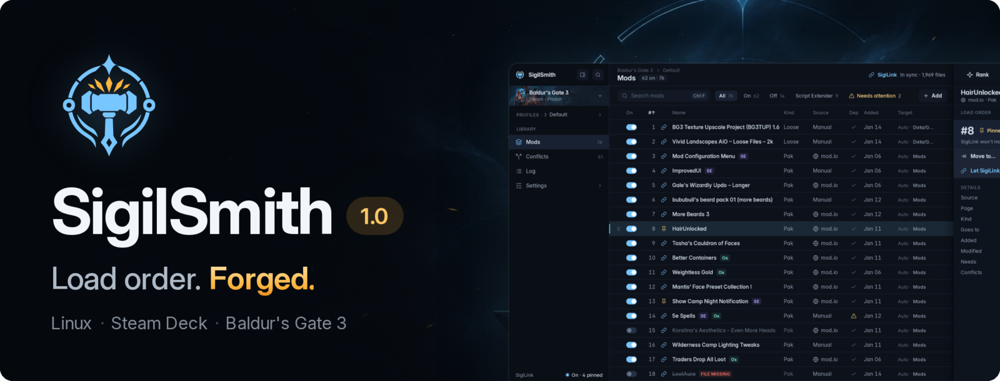
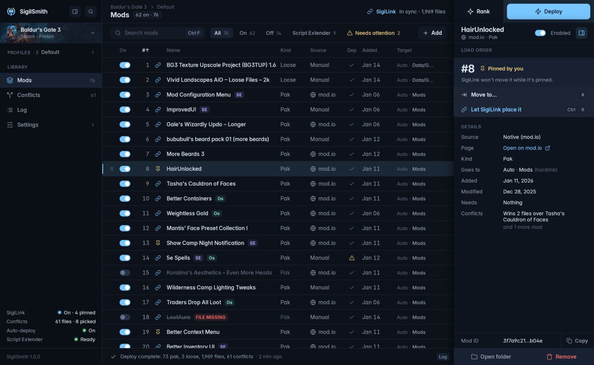
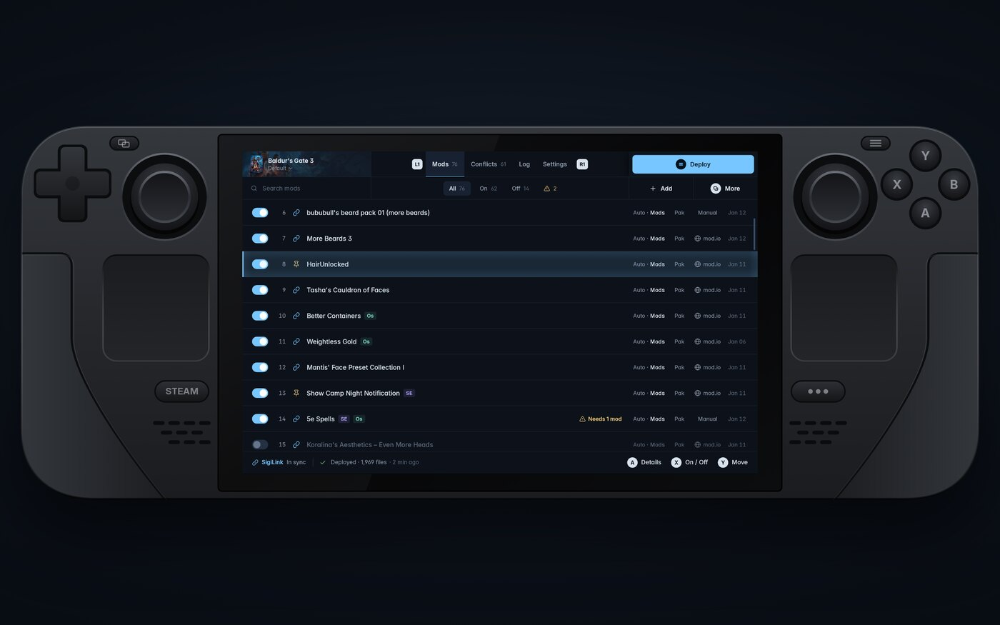
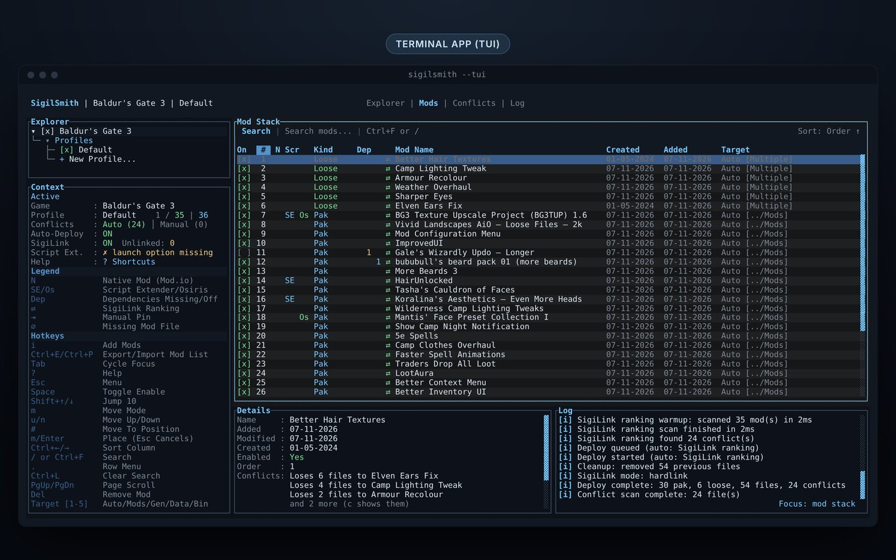

# SigilSmith

A free, Linux-first mod manager for Baldur's Gate 3. Drop your mods in, put
them in order, deploy, and play. It's a desktop app with a layout for the
Steam Deck's screen and controller, and it also runs in your terminal, keyboard
first. Steam (native or Proton), GOG, Heroic, Lutris, Faugus, Bottles and the
Steam Deck all work. SigilSmith is for Linux now; Windows and macOS are coming
later.

**[Download the latest release](https://github.com/Agistaris/SigilSmith/releases/latest)**
· [Install guide](docs/install.md)
· [Troubleshooting](docs/troubleshooting.md)
· [Changelog](CHANGELOG.md)
· [Report a bug or suggest an idea](https://github.com/Agistaris/SigilSmith/issues)

<table>
<tr>
<td width="33%"></td>
<td width="33%"></td>
<td width="33%"></td>
</tr>
<tr>
<td align="center">Desktop app</td>
<td align="center">Steam Deck</td>
<td align="center">Terminal app</td>
</tr>
</table>

## Our promises

- **SigilSmith stays free.** No paywall on the mod manager, ever.
- **No lock-in.** Your library and load order are in documented files
  ([file formats](docs/file-formats.md)), and you can export your mod list at
  any time, as SigilSmith JSON or as a `modsettings.lsx` other managers read.
- **No telemetry.** SigilSmith sends no usage data. If optional usage
  reporting is ever added, it will be off unless you turn it on, and it will
  be documented before it ships.
- **Works offline, no account.** Nothing needs a sign-in or a server.
  SigilSmith checks nothing online until you say yes.
- **You can see what it touches.** [What SigilSmith touches](docs/what-sigilsmith-touches.md)
  lists every folder it reads or writes and every network call it makes.
- **Native Linux packages.** AppImage, `.deb`, `.rpm` and `.tar.gz`, each with
  a published SHA-256 checksum.
- **If SigilSmith is ever discontinued,** we'll publish a final release that
  works fully on its own, and the file formats stay documented. SigilSmith
  uses no servers today; if optional online features come later, that final
  release won't need them.

## About the source code

Up to version 0.9.11, SigilSmith's source code was published here. SigilSmith
is now a bigger project, with a graphical app for the desktop and the Steam
Deck and more games to come, and its development has moved to a private
repository. This repository stays its public home: releases, docs, the
changelog and the issue tracker.

Nothing changes in how you use it. SigilSmith is free, it keeps every promise
above, and everything you need to trust it, script it or move away from it is
documented here: [what it touches](docs/what-sigilsmith-touches.md),
[file formats](docs/file-formats.md) and the [CLI reference](docs/cli.md).
Every release is published with SHA-256 checksums.

## What it does

- **Two apps, one program:** run `sigilsmith` for the desktop app, or
  `sigilsmith --tui` for the terminal app. Both manage the same mods,
  profiles and backups. With no display (over SSH, on a text console) a plain
  `sigilsmith` opens the terminal app and says so.
- **Easy imports:** drag `.zip`, `.7z` or `.pak` files (or whole folders) into
  the window.
- **Keeps your load order:** reads your existing `modsettings.lsx` on first
  launch, so an order from BG3 Mod Manager or the in-game mod manager carries
  straight over.
- **Profiles:** separate mod setups for different playthroughs.
- **Conflicts:** when two mods include the same file, the one lower in your
  load order wins, and you can pick a different winner for any file.
- **SigiLink:** fast deploys from SigilSmith's library by hardlink or symlink
  instead of copying, and optional ranking that orders your mods (or shows
  the changes first, if you prefer) and keeps the positions you pin.
- **Dependencies and missing mods:** see what each mod needs; missing mods stay
  in your list as placeholders.
- **Native and Proton:** switch whenever you like; SigilSmith moves your setup
  with a backup.
- **Script Extender help:** see which mods need it, and let SigilSmith check or
  finish the setup.
- **Backups:** every deploy makes one, and you can restore any of the newest
  100 (you can keep 50 to 500) and undo the restore. Saved backups are yours
  to name and never deleted to make room.
- **Command line:** list mods, profiles and dependencies as text or JSON,
  import mods and take them out of the game from scripts
  ([CLI reference](docs/cli.md)).

## Install

Download a package from the
[latest release](https://github.com/Agistaris/SigilSmith/releases/latest):

| Package | For |
| --- | --- |
| AppImage | Almost any distro, and the Steam Deck in Desktop Mode |
| `.deb` | Debian, Ubuntu, Mint, Pop!_OS |
| `.rpm` | Fedora, openSUSE |
| `.tar.gz` | Any distro |

The [install guide](docs/install.md) has the commands, how to check the
download and how to uninstall. On first launch SigilSmith finds BG3 and its
Larian data folder by itself; if it misses something, open **Settings → Game**
in the desktop app, or **Esc → Folders** in the terminal app.

## Docs

| Page | What's in it |
| --- | --- |
| [Install guide](docs/install.md) | Packages, checksums, first launch, NixOS, updates, uninstalling |
| [What SigilSmith touches](docs/what-sigilsmith-touches.md) | Every folder it reads or writes, every network call, how to turn them off |
| [Troubleshooting and FAQ](docs/troubleshooting.md) | Mods not loading, Script Extender, missing mods and dependencies, load order, the log, backups, AppImage and update questions |
| [CLI reference](docs/cli.md) | Commands, options and JSON output |
| [File formats](docs/file-formats.md) | The mod list export, the library, settings and backups |
| [Changelog](CHANGELOG.md) | What changed in each release |

## Bugs and ideas

Check [Troubleshooting and FAQ](docs/troubleshooting.md) first: it covers the
common questions. Then open an
[issue](https://github.com/Agistaris/SigilSmith/issues) or comment on the
[Nexus Mods page](https://www.nexusmods.com/baldursgate3/mods/20561).
These help a lot: your distro, how you run BG3 (Steam native, Steam with
Proton, GOG and so on) and your log (**Copy Last 200 Log Lines**,
**Copy Log (This Session)** or **Export Log File**, in the Log screen's menu
or the terminal app's **Esc** menu;
[how to find them](docs/troubleshooting.md#where-is-the-log-and-how-do-i-share-it)).

## Support SigilSmith

SigilSmith is free and stays free. If it saves you time, a tip helps keep it
going:

<!-- Ko-fi is live (owner 2026-10-31); GitHub Sponsors still to set up before 1.0.0 -->
- [GitHub Sponsors](https://github.com/sponsors/Agistaris) (GitHub takes no fee)
- [Ko-fi](https://ko-fi.com/agistaris) (no fee on one-time tips)
- [PayPal](https://www.paypal.com/donate/?hosted_button_id=X7R6DZDE9NUHN) (any amount, by card or PayPal)
- [Nexus Mods](https://www.nexusmods.com/baldursgate3/mods/20561): downloading SigilSmith there earns us Donation Points

## License and trademarks

SigilSmith is free for anyone to use, for anything, including videos and
streams, under the [SigilSmith License](LICENSE). Please don't sell, re-host
or redistribute it; link to the
[releases](https://github.com/Agistaris/SigilSmith/releases) instead. Linux
package maintainers may package the official release files without asking;
the license has the conditions. "SigilSmith" and its logo are trademarks of
CipherChow LLC ([TRADEMARKS.md](TRADEMARKS.md)).

SigilSmith is a community tool, not affiliated with Larian Studios or Nexus
Mods. Thanks to saghm for the `larian_formats` crate SigilSmith uses to read
BG3's pak and `modsettings.lsx` formats.
